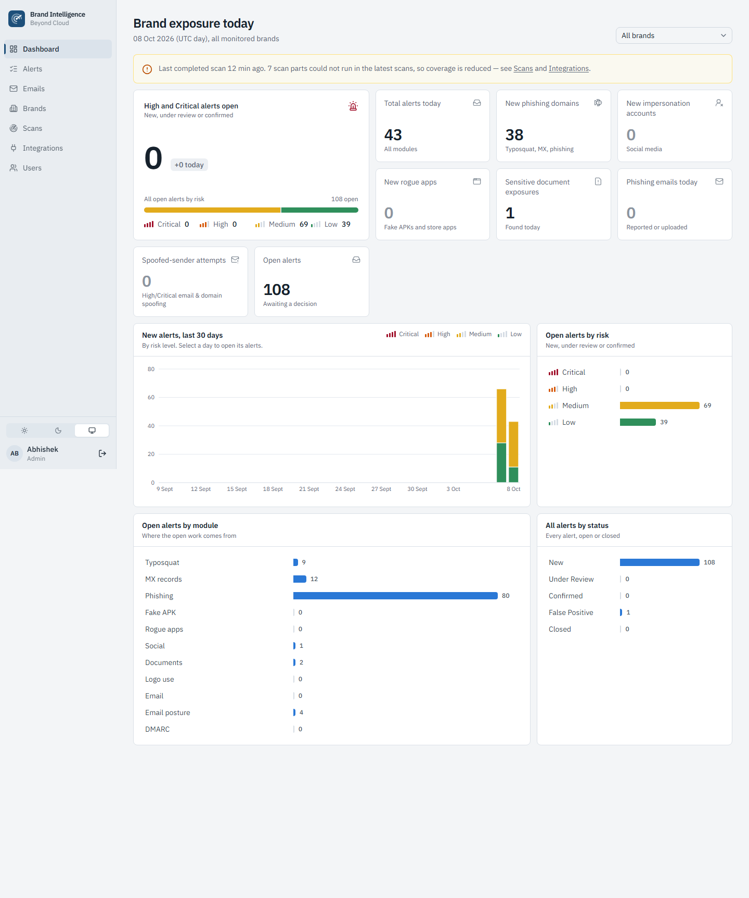
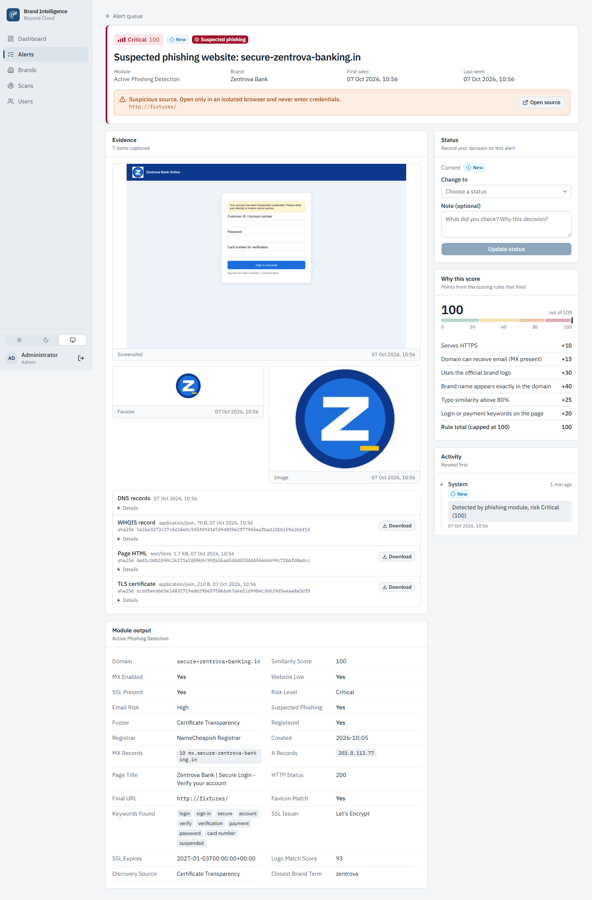
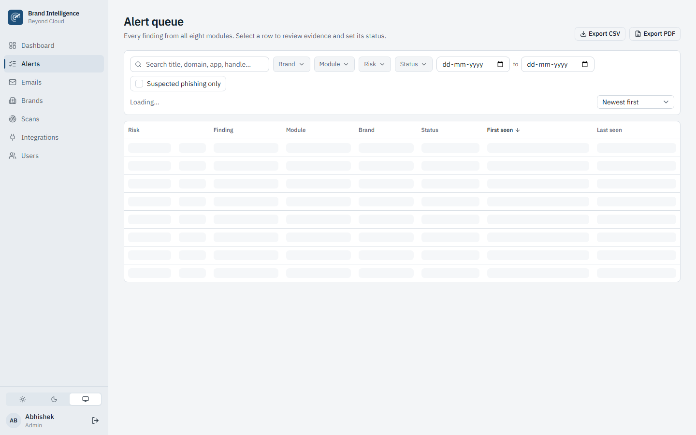
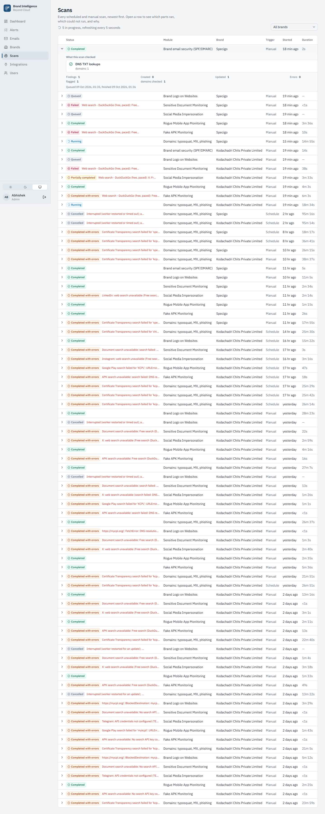
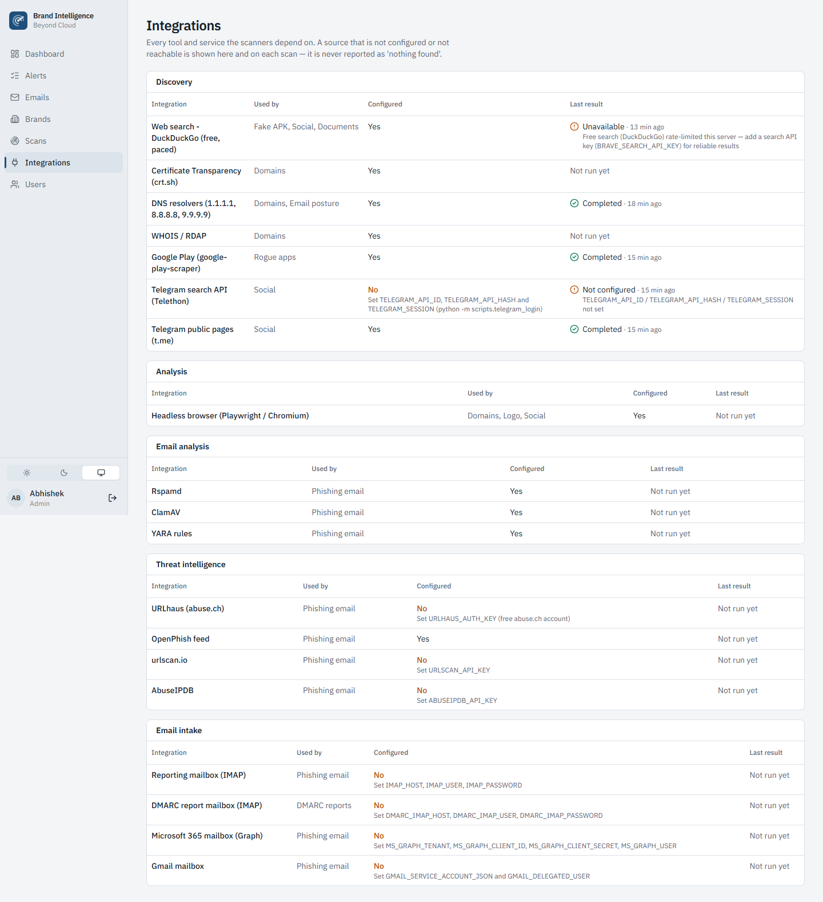
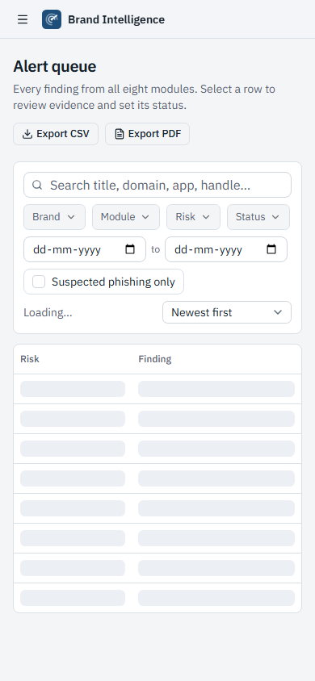

# Demo Guide — Beyond Cloud Brand Intelligence Platform

A 20-minute demo script that walks through every Phase-1 requirement, with what to click, what to say, and
answers to the questions people usually ask. Requirement IDs (e.g. AC-03) point to
`docs/requirements/01-requirements-register.md`; decisions (D-xx) to `docs/decisions/DECISION-LOG.md`.

---

> **Note (D-27, D-32):** the product shows real scanned data only and has **no demo mode**. Present with your real
> brand (e.g. Kodachadri Chits): the same screens and steps apply. The Zentrova examples below are the fictional
> test brand, which exists only inside the automated test suite — use them as explanations of what each module
> detects.

## Before the demo (10 minutes, once)

```bash
docker compose -f deploy/docker-compose.yml --profile app up -d
```

1. Open **http://localhost:3000**, sign in as the admin.
2. **Brands → (your brand) → Run scan now → All modules**. Live scans take minutes (the domain pipeline the
   longest). On the **Scans** page every run ends *Completed*, *Partially completed*, *Completed with errors*,
   *Failed* or *Cancelled* — expand a row to see **What this scan checked**.
3. Open **Integrations** and note which tools are not configured (for example Telegram API, search API key) — be
   ready to say so before anyone asks.
4. Keep these tabs open: Dashboard, Alerts, the brand page, Scans, Integrations, `docs/reports/UAT-REPORT.md`.
5. Optional: a second browser window at phone size (or dev-tools device mode) for the responsive view.

> **What is Zentrova Bank?** A fictional bank (D-09) used only by the automated acceptance tests. Its phishing
> site, fake APK, fake social accounts and leaked documents are simulated sources that the tests inject into the
> real module runners (`backend/tests/support/fixture_sources.py`), so the tests are repeatable and never touch a
> real client. It cannot be created in the product.

---

## Script

### 1. The problem and the promise (1 min)

*"Attackers abuse a brand in eight ways: look-alike domains, domains set up to send phishing email, live phishing
sites, fake APKs, rogue store apps, fake social accounts, leaked documents and stolen logos. Today an analyst
checks these by hand. This platform watches all eight continuously, scores each finding the same way, keeps the
evidence, and gives analysts one queue to work from."*

### 2. Executive dashboard (2 min) — DSH-01…06, DSH-17



- Point at the six tiles: *total alerts today, High/Critical, new phishing domains, new impersonation accounts,
  new rogue apps, sensitive document exposures* — "exactly the six numbers the requirements asked for".
- Trend chart: "new alerts per day by risk; click a day to open those alerts".
- Click the **High and Critical** tile → lands on the alert queue already filtered. "Every number is a link to the
  work behind it."
- The banner above the tiles: *"No threats detected."* appears only after a scan has actually completed, together
  with the time of the last completed scan and "N scan parts could not run" when coverage was reduced. Before any
  scan it says *"No scans have run yet"* — "a quiet dashboard means checked and clean, never couldn't check"
  (D-31).

### 3. Brand onboarding (2 min) — FND-04/05/06, OUT-01

Open **Brands → Zentrova Bank**.
- Keywords and product terms: "what the brand is called and what it sells".
- Official assets: logo, favicon, app icon — "fingerprinted on upload; we compare every image we find against
  these".
- Allowlists: official domains, packages, publishers, social handles, email domains — "the brand's own things,
  never alerted. This is the main false-positive control."
- *"Adding a real client is the same form — five minutes."* (See `docs/guides/BRAND-CONFIGURATION.md`.)

### 4. Domain intelligence — the story of one phishing domain (4 min) — AC-01, AC-02, AC-03

Alerts → filter **Module: Typosquat, MX, Phishing**.

- **AC-01 typosquat:** "From zentrova.com the engine generates ~12,000 look-alikes: omission, substitution,
  transposition, homoglyphs, prefixes/suffixes, insertions and other TLDs (.in .net .org .co and country TLDs) —
  then checks which are registered, daily." Show `zentorva.in` (transposition, *Typosquat* stage, Low).
  On the **Scans** page expand the domains scan: *variants generated by pattern*.
- **AC-02 MX:** open `zentr0va.com` — "zero instead of o; it has a mail server, so it can send phishing email.
  *Email Risk: Medium*. If it also hosts a website, Email Risk becomes High — that's the §3.1 MX rule (D-02)."
- **AC-03 live phishing:** open `zentrova-login.com`.



  - Screenshot of the fake login page, favicon (matched to ours), the copied logo (match 93), TLS certificate,
    WHOIS (registered 1 Oct), DNS, page HTML — "everything an analyst or a takedown request needs".
  - **Why this score**: "+40 exact brand in the domain, +25 look-alike, +15 mail server, +10 HTTPS, +20 login
    keywords, +30 our logo → capped at 100, Critical. Same table for every module, so scores are comparable."
  - **Suspected Phishing** badge: "look-alike *and* live *and* showing a login form, our favicon or logo (D-04).
    `zentrova.org` is live too but shows a gardening blog — no badge."
  - "One alert per domain that moves Typosquat → MX → Phishing as the attacker builds it out (D-19); the history
    shows when each step happened."
- Mention `secure-zentrova-banking.in`: "not produced by our typo patterns — caught from Certificate Transparency
  logs, the moment it got a certificate."

### 5. Mobile (2 min) — AC-04, AC-05

- **Fake APK:** filter *Fake APK*. "'Zentrova Mobile Banking' on an APK mirror, package
  `com.zentrova.mobilebanking.secure`, developer *ZB Apps Studio* — not our publisher, our icon. We downloaded it
  into evidence, hashed it (SHA256) and read only the manifest — never installed or run it." Point out the official
  app on the same mirror was **not** flagged (allowlisted package + publisher).
- **Rogue Play apps:** filter *Rogue app*. "'Zentrova Bank Loan Helper' by QuickLoan Apps, 10,000+ installs, uses
  our logo and 'netbanking'. The listing is tracked daily — New / Updated / Removed — so you see when a takedown
  worked."

### 6. Social impersonation (2 min) — AC-06

Filter *Social*. Open `@zentrova_support` on X.
- "Handle contains our name, display name 'Zentrova Bank Support', our logo as avatar, bio says 'DM us your
  account number'. Found on X, Instagram, Facebook, LinkedIn and Telegram." The official `@zentrovabank` is not
  flagged.
- Open `@zen_trivia` (Low) → **change status to False Positive** with a note: "similar letters, unrelated quiz
  account — the analyst's decision is recorded."

### 7. Sensitive documents (1.5 min) — AC-07

Filter *Documents*. Open *Zentrova_Internal_Salary_Review_2026.pdf*.
- "Found through search, downloadable without login. Contains 'confidential', 'salary', six @zentrova.com
  addresses → Exposure Confidence High, Critical. The public brochure is Medium, not Critical — the rules separate
  marketing material from a leak (D-06)."

### 8. Logo misuse (1 min) — AC-08

Filter *Logo*. Open the partner page alert: "a third-party offers page using our logo next to another bank's.
Perceptual hashing finds it even resized and re-compressed; the unrelated page in the same crawl was not
flagged."

### 9. Analyst workflow and exports (2 min) — AC-09, AC-10, DSH-10, DSH-18/19

- Alert queue with all modules ("AC-09: every module in one queue").



- Open a phishing alert → **Under Review** with a note → **Confirmed** → **Closed** ("taken down"). Show the
  activity history: who, when, from → to, note. The status menu only offers the allowed next steps (D-07).
- Filter Critical + High → **Export CSV** and **Export PDF**: "same filters as the screen; the CSV has the exact
  output columns from the requirement tables."

### 10. Honest scan status (1.5 min) — RDA-02, RDA-03, RDA-17, D-31



- **Scans** page: hover a status badge for its meaning; expand a row → **What this scan checked** lists every part
  (DNS resolution, WHOIS/RDAP, Web search - <provider>, Telegram API …) as Completed, Skipped, Not configured,
  Unavailable or Failed, with counts and the reason.
- *"If DNS times out, the domain is 'unresolved' and retried next scan — never 'not registered'. If a page
  answered but couldn't be captured, it says 'Website Live: unknown (capture failed)'."*



- **Integrations** page: every tool the scanners depend on, whether it is configured (and how to configure it), and
  its last real result — "Not run yet" until there is evidence, never assumed OK.

### 11. Proof — the UAT report (1 min) — DEL-07

Open `docs/reports/UAT-REPORT.md`: "every requirement has an ID, every ID is tagged on the automated tests that
prove it, and this report is generated from the test run. All ten acceptance criteria pass."

### 12. Phone view (30 s) — DSH-20



---

## Talking points by theme

| Theme | Say |
|---|---|
| Consistent scoring | One points table for all modules; every alert shows which rules fired (§6, D-02, D-03, D-20) |
| Evidence | Screenshots, favicon, WHOIS, DNS, TLS, HTML, files with SHA256 — captured automatically, stored once (D-21) |
| False positives | Allowlists, thresholds, the False Positive status, and a negative test for each module |
| Safety | All internet access through one safe fetcher; internal addresses blocked on every redirect; isolated browser; downloaded files never executed (D-18) |
| Repeatability | The automated tests inject simulated sources for a fictional test brand into the same runners that scan real brands live (D-09, D-32) |
| Honesty | Every scan lists which parts ran, which were not configured or unavailable and which failed; unknown is never reported as "no" (D-31) |
| Traceability | Requirement register → tests → UAT report; decision log for everything not specified |

## Likely questions

| Question | Answer |
|---|---|
| Is this using real data? | Yes — the product has no demo mode. Every alert comes from live DNS, WHOIS/RDAP, Certificate Transparency, Google Play, web search and Telegram. Simulated data exists only inside the automated tests (D-32). |
| What if a source is down? | The scan says so: the component shows Unavailable or Failed, the run is *Partially completed* or *Completed with errors*, and the dashboard counts the parts that could not run (D-31). |
| How do you find *newly registered* domains without a paid feed? | Every look-alike is re-resolved daily, and Certificate Transparency catches new sites when they get a certificate. A paid NRD feed can be plugged in as another source (D-11). |
| Why not scrape Instagram/Facebook/LinkedIn directly? | Their terms forbid it and they need logins. We find public profiles through search — what a victim would find (D-10). Telegram uses its official API. Paid social APIs can be added later. |
| Do you install the APKs? | Never. We store, hash and read the manifest only — no execution, no decompiling (reverse engineering is out of scope, OOS-03). |
| How fast is it? | ~12,000 look-alikes per domain checked in about 2.5 minutes; a live site captured in 2–4 seconds (OPERATIONS.md). |
| Can it file takedowns automatically? | Out of scope for Phase 1 (OOS-01). The evidence package and PDF export are what a takedown request needs. |
| Is AI used to classify phishing? | Not in Phase 1 (OOS-02) — the scoring is rule-based and explainable. A classifier is a natural Phase 2. |
| Multi-tenant client portal? | Phase 2 (OOS-05). Today it is one internal deployment monitoring many brands. |
| Where does it run? | Docker Compose on any Linux VM; evidence in any S3-compatible store (D-16, D-22). |
| What's needed to go live? | A search API key, Telegram API credentials, hosting details and authorisation per brand — DEPLOYMENT.md §3. |
